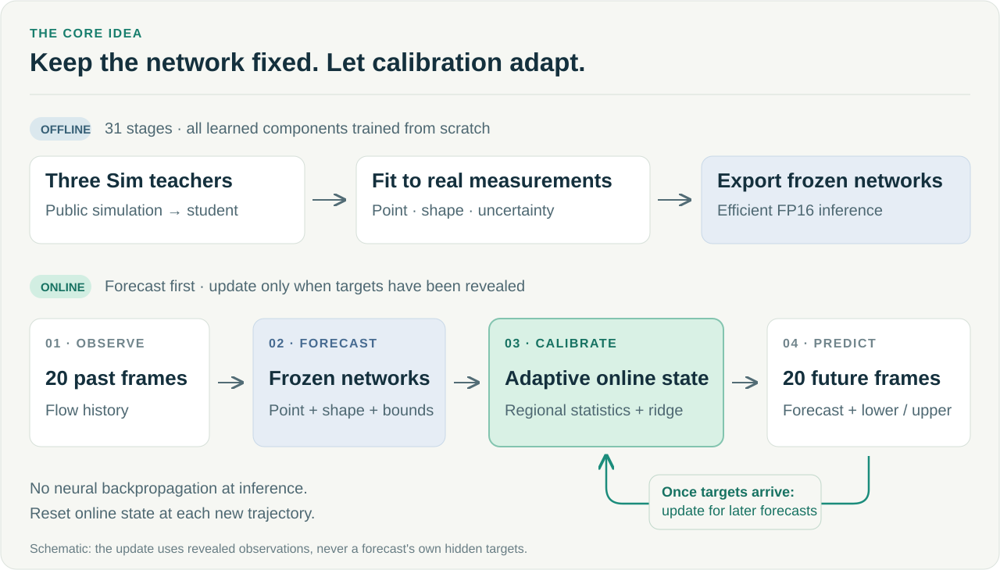

<div align="center">

# Cupid

### Uncertainty-Aware Flow Forecasting with Causal Online Calibration

**NeurIPS 2026 RealPDE Competition · Track 2: Long-Term Test-Time Adaptation**

**Yaoyu Chang · Wenhao Liu · Hao Shi**

[Official final results](https://realpdecompetition.github.io/results.html) · [Method](docs/method.md) · [Reproduce](docs/reproduction.md) · [Results & evidence](docs/results.md) · [中文](README_ZH.md)

**Joint 9th place on the official private test set** · **31-stage training from scratch** · **Single-A800 Docker reproduction**

</div>



## Forecast the flow. Calibrate as observations arrive.

Real-world flow forecasting must handle a gap between simulation and measurement,
uncertainty in future velocity fields, and changing conditions during deployment.
Cupid combines a frozen flow forecaster with lightweight online calibration:
**neural-network weights stay fixed; statistics and a regional linear readout
adapt using already revealed targets.**

This repository presents Team Cupid's competition solution, **Codabench 948801
(L33)**. It preserves the complete submitted training package and adds a navigable
method guide, reproduction instructions, and clearly separated official and local
results.

## At a glance

| Item | Details |
|---|---|
| Task | Predict the next 20 flow frames from 20 observed frames |
| Evaluation grid | 32 × 64; channels `u`, `v`, and zero pressure on Real data |
| Offline learning | Three Sim teachers → student → Real point/shape/UQ training → export |
| Online adaptation | Regional mean/amplitude calibration, residual-CDF intervals, and a 32-feature ridge readout |
| Neural gradient updates at inference | None |
| Public Final API | `train(data_dir, output_dir, device)` and `get_ttt_model(output_dir, device)` |
| Official identity | Team **Cupid** · Codabench **andychang** · submission **948801** |

## Results

| Evidence | Result | Meaning |
|---|---|---|
| **Official final/private test** | **Joint 9th; 82.6104 ± 0.0653** | Organizer-reported mean and standard deviation over 15 evaluations |
| Development submission | 82.186978 | Historical official score for submission 948801 |
| Local Docker training | 31/31 stages; **4 h 07 min 24 s** | One A800-SXM4-80GB; 16 CPUs; 128 GB RAM; network disabled |
| Local paired public replay | Tail quality mean **83.271780 vs. 83.277454** | Fresh model vs. sealed submission; difference −0.005674 points |

The [official results page](https://realpdecompetition.github.io/results.html)
describes three independent organizer training runs and five evaluations per
trained model. The local replay is a **training-overlap diagnostic**, and its
four-metric quality mean excludes the official Time score. It is not comparable
to the official total scores. See [results and limitations](docs/results.md).

## Method in three parts

1. **Learn offline from simulation and measurements.** Three independently trained
   Sim teachers supervise a compact multi-member U-Net. Real-data fits learn point
   forecasts, fluctuation shape, input-conditioned mean calibration, and asymmetric
   uncertainty bounds.
2. **Adapt causally without neural backpropagation.** Revealed past targets update
   regional means, fluctuation amplitudes, empirical residual distributions, and
   a regularized linear readout. State is reset for every trajectory.
3. **Execute efficiently.** The frozen runtime combines mixed INT8/FP16 weight
   storage, FP16 inference, Torch compilation, reusable buffers, and CUDA graphs.
   Storage compression does not imply INT8 compute kernels.

[Method guide →](docs/method.md) · [Exact 31-stage recipe →](submission/METHOD.md) · [Code map →](docs/code-map.md)

## Reproduce

The public path is to **build from source**. Pull access to the historical private
Docker Hub repository is not required. Use a Linux host with Docker Engine,
NVIDIA container support, and one exposed A800 80 GB GPU for the tested setup.

```bash
# From this repository's root; this check needs only Python's standard library.
python scripts/verify_source.py

# Build needs access to the pinned base image unless it is already cached.
# All additional Python wheels are bundled.
docker build --platform linux/amd64 -t cupid-realpde:948801 ./submission

# DATA must contain the official flat-HDF5 training release; see the data guide.
DATA=/absolute/path/to/public-training-data
OUTPUT=/absolute/path/to/new-empty-output
mkdir -p "$OUTPUT"

docker run --rm --network none --gpus '"device=0"' \
  --cpus 16 --memory 128000000000 --shm-size 32g \
  --mount type=bind,src="$DATA",dst=/data,readonly \
  --mount type=bind,src="$OUTPUT",dst=/output \
  cupid-realpde:948801 \
  python -c "import solution; solution.train('/data', '/output', 'cuda')"
```

Training starts with empty output and rebuilds every learned component, including
teachers and caches. It does not use historical weights or a sealed submission.
Full training requires CUDA; the standard-library integrity check does not.

**Read the [data layout](docs/data.md) and [complete reproduction guide](docs/reproduction.md)
before running.** The raw benchmark download and the competition-ready HDF5 layout
must not be confused.

## Repository guide

| Path | Purpose |
|---|---|
| [`submission/`](submission/) | All 1,835 files from the frozen Final source ZIP, byte-for-byte |
| [`submission/solution.py`](submission/solution.py) | Official training and inference entry points |
| [`submission/pipeline.py`](submission/pipeline.py) | Fixed 31-stage schedule, data checks, and training report |
| [`submission/runtime/track2/`](submission/runtime/track2/) | Deployed L33 inference and online calibration |
| [`docs/`](docs/) | Method, data, reproduction, results, and provenance |
| [`evidence/`](evidence/) | Selected local Docker execution receipts and result tables |
| [`scripts/verify_source.py`](scripts/verify_source.py) | Verify the frozen package against its SHA256 manifest |

The retained `legacy/`, `teacher_legacy/`, and `runtime/track1/` directories inside
the package are historical dependencies, not separate supported releases. The
executable training entry point in this repository is **Track 2 only**.

The original package documentation is kept unchanged as a dated submission
record. The October 10 Docker Engine run happened later; its evidence is described
in [the current reproduction guide](docs/reproduction.md).

## Team and citation

Team Cupid: **Yaoyu Chang** (team leader), **Wenhao Liu**, **Hao Shi**.
The software citation metadata is in [CITATION.cff](CITATION.cff).
This is a competition solution release, not a claim of an accepted research paper.

We thank the [RealPDE competition organizers](https://realpdecompetition.github.io/)
and [RealPDEBench authors](https://github.com/AI4Science-WestlakeU/RealPDEBench)
for the benchmark, public data, interfaces, and evaluation infrastructure.
Please also cite the upstream work when using the benchmark.

## Licensing and data

Cupid's team-authored code and documentation use the [MIT License](LICENSE).
Third-party notices and source licenses are preserved in
[`submission/THIRD_PARTY_NOTICES.md`](submission/THIRD_PARTY_NOTICES.md).
The [public competition dataset](https://huggingface.co/datasets/AI4Science-WestlakeU/RealPDE-Competition-Data)
is distributed separately under its own terms. No training trajectories, model
checkpoints, Docker image layers, account credentials, or private correspondence
are included here. See [licensing status](docs/licensing.md) for reuse conditions.
