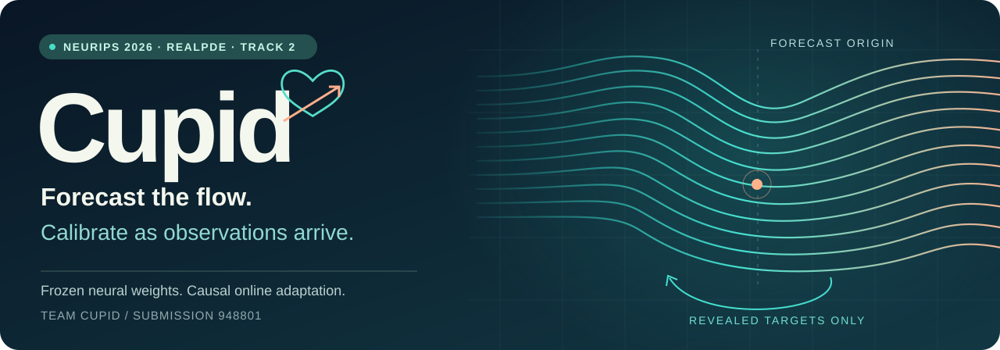
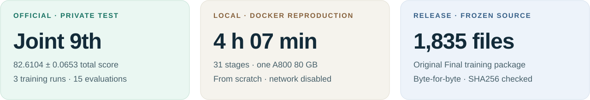
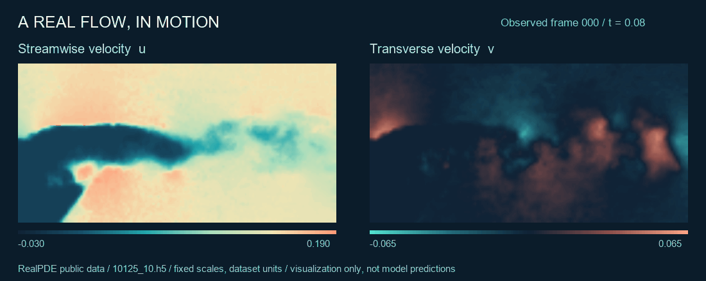
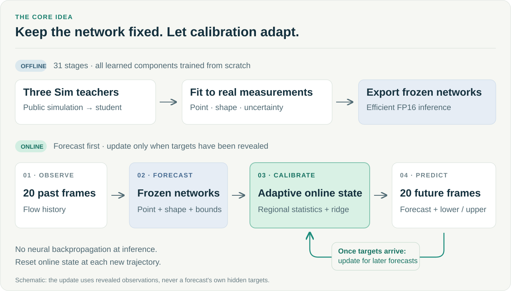

<div align="center">

<picture>
  <source media="(max-width: 600px)" srcset="docs/assets/cupid-hero-mobile.svg">
  
</picture>

### 不确定性感知流场预测与因果在线校准

**Yaoyu Chang · Wenhao Liu · Hao Shi**

NeurIPS 2026 RealPDE Competition · Track 2：长期测试时适应（LTTTA）

**[NeurIPS 官方 Poster 展示页](https://nips.cc/virtual/2026/loc/sydney/181002)** · **[官方最终结果](https://realpdecompetition.github.io/results.html)**

**[English](README.md)** &nbsp; / &nbsp; **[方法](#方法如何工作)** &nbsp; / &nbsp; **[复现](#从源码复现)** &nbsp; / &nbsp; **[结果](#已验证的结果)** &nbsp; / &nbsp; **[代码导航](docs/code-map.md)**

</div>

Cupid 在预测未来流场及其不确定性的同时，利用持续到来的观测进行校准。
**神经网络保持冻结；已经揭示的历史目标，驱动轻量校准状态不断更新。**
这里完整公开了 Cupid 队的比赛方案 **948801（L33）**。

<a href="docs/results.md"><picture>
  <source media="(max-width: 600px)" srcset="docs/assets/cupid-evidence-mobile.svg">
  
</picture></a>

## 看见真实流动



<sub>公开轨迹 <code>10125_10.h5</code> 的实测速度分量 u、v。色标固定，播放速度仅用于展示，不代表真实时间比例。[静态版本](docs/assets/real-flow-preview.png) · [数据来源、绘制参数与署名](docs/assets/README.md)</sub>

**任务：**从 20 帧历史观测预测未来 20 帧及上下界。评测使用 32×64 网格，Real 数据的压力通道为零；上方动图展示原始 64×128 观测网格。

## 方法如何工作

<picture>
  <source media="(max-width: 600px)" srcset="docs/assets/cupid-overview-mobile.svg">
  
</picture>

1. **离线学习。**三个独立 Sim 教师指导多成员 U-Net，再通过 Real 数据拟合点预测、波动形状、均值校准和非对称不确定性区间，形成固定的 31 阶段链路。
2. **因果校准。**已经揭示的历史目标更新区域均值、波动幅度、残差分布和 32 维特征的正则线性读出；每条轨迹重置状态，推理阶段没有神经网络反向传播。
3. **高效执行。**FP16 推理、Torch 编译、缓冲区复用和 CUDA Graph。权重混合 INT8/FP16 **存储**不等于使用 INT8 计算内核。

[方法详解 →](docs/method.md) · [完整 31 阶段配方 →](submission/METHOD.md)

## 从源码复现

**构建镜像 → 从头训练 → 加载 Final 接口。**
已实测环境为 Linux/amd64、Docker Engine、NVIDIA 容器支持和单张 A800 80 GB。
从公开源码构建即可，不依赖历史私有 Docker Hub 仓库。

```bash
git clone https://github.com/andychangyy-maker/Cupid-RealPDE.git
cd Cupid-RealPDE

# 无需 GPU，仅使用 Python 标准库核验原始包。
python scripts/verify_source.py

# 固定基础镜像；额外 Python wheels 已包含。
docker build --platform linux/amd64 -t cupid-realpde:948801 ./submission
```

正式训练从空输出目录开始，在断网容器内重建教师、缓存及全部学习组件，不复用旧权重。
构建镜像本身可能需要联网获取基础镜像。运行前请先核对官方数据的目录格式。

**[完整复现指南 →](docs/reproduction.md)** · [数据准备 →](docs/data.md) · [执行记录 →](evidence/README.md)

## 已验证的结果

| 证据类型 | 结果 | 含义 |
|:--|:--|:--|
| **官方最终私有测试集** | **并列第 9；82.6104 ± 0.0653** | 15 次官方评测的总分均值与标准差 |
| 官方开发榜提交 | 82.186978 | 948801 的历史开发榜成绩 |
| 本地 Docker + A800 复训 | **31/31 阶段；4 小时 7 分 24 秒** | 单 A800、16 CPU、128 GB 内存、训练断网 |
| 本地公开数据配对回放 | 复训 83.271780 / 封存版 83.277454 | 716 尾窗质量均值；差 −0.005674 |

最终名次来自[官方结果页](https://realpdecompetition.github.io/results.html)：三次独立从头训练，每次五次评测。
本地回放与训练数据重叠，属于复现诊断；其质量均值不包含官方 Time 分数，不能替代或直接对比官方总分。

[指标定义、证据与局限 →](docs/results.md)

## 探索代码

| 入口 | 内容 |
|:--|:--|
| [方法说明](docs/method.md) | 模型结构、校准状态和因果边界 |
| [核心代码导航](docs/code-map.md) | 每个组件对应的实现位置 |
| [冻结源码](submission/) | 原 Final 源码包 1,835 个文件，逐字节保留 |
| [复现记录](evidence/) | Docker 训练、Final API 与公开配对回放 |
| [SHA256 清单](docs/frozen-source-manifest.json) | 可用完整性脚本独立核对 |

<details>
<summary>保留历史目录的说明</summary>

原包的 `legacy/`、`teacher_legacy/` 和 `runtime/track1/` 是训练或推理依赖，不代表单独支持 Track1 发布。
当前公共训练入口只支持 Track2。原包 README 保持提交时的内容，10 月 10 日完成的 Docker Engine 全流程记录由外层复现指南补充。

</details>

## 团队、引用与致谢

**Cupid：**Yaoyu Chang（队长）、Wenhao Liu、Hao Shi。
软件引用信息见 [CITATION.cff](CITATION.cff)。这是比赛方案的公开发布。

感谢 [RealPDE 组织方](https://realpdecompetition.github.io/)和
[RealPDEBench 作者](https://github.com/AI4Science-WestlakeU/RealPDEBench)提供数据、接口与评测环境。
使用基准时，请同时引用上游工作。

---

团队原创代码和文档采用 **[MIT 许可](LICENSE)**，原有第三方许可保留。
流场动图来源于 **CC BY-NC 4.0** 公开数据，其使用条件单独保留，详见[图像署名](docs/assets/README.md)及[许可说明](docs/licensing.md)。
仓库不包含原始训练轨迹、模型检查点、Docker 镜像层或账号凭据。
