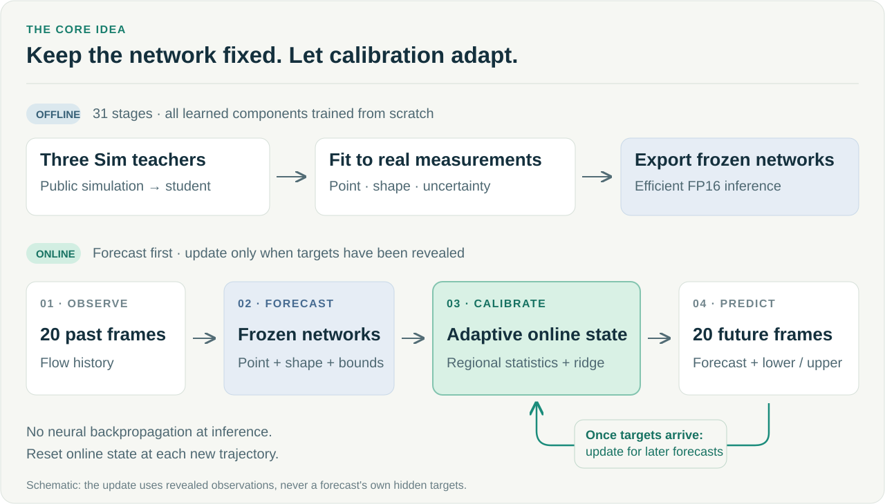

# Method guide

[Home](../README.md) · [Exact training recipe](../submission/METHOD.md)

## The design

A stable predictor and an adaptive calibration layer serve different roles.
The predictor learns spatiotemporal structure offline; the calibration layer
uses feedback available during streaming evaluation to adjust the next forecast.
Cupid does not optimize neural-network parameters at test time.

## Offline: rebuild the complete dependency chain

The fixed training schedule has 31 stages:

| Stages | Operation | What it produces |
|---|---|---|
| 1–3 | Train Sim teachers A, B, and C from random initialization | Three teacher models |
| 4–5 | Recompute teacher predictions and Real-prefix closure statistics | Training caches |
| 6–8 | Noisy-history pretext training and two standard Sim stages | Student initialization |
| 9–23 | Five point/shape fits and corresponding held-angle mean caches | Stage-OOF calibration data |
| 24–27 | Full Real point, native uncertainty, shape, and mean fitting | Deployed prediction components |
| 28–30 | Deployed-output uncertainty fitting, reflection distillation, and fixed UQ blending | Final uncertainty parameters |
| 31 | Fixed INT8/FP16 storage export | Inference package |

The student is a four-member U-Net (base width 128, depth 3). It has 18,778,953
parameters, including a 2,814,022-parameter uncertainty component. A separate
4,403,660-parameter Real-data model estimates normalized fluctuation shape.
The full recipe specifies seeds, losses, steps, optimizers, and endpoint rules.

All learned components originate inside the same `train()` call. An earlier
stage's output may initialize a later stage, but an externally trained checkpoint
is not an input to this training API.

## Online: update only with revealed feedback

For trajectory window `t`, the API receives current history `input_norm` and,
when available, the **previous** target `prev_target_norm`. It returns the next
20-frame prediction and asymmetric lower/upper bounds. The current target is
not an input to its own forecast.

The runtime updates:

- **Regional mean and amplitude statistics**, to adjust average flow and fluctuation scale.
- **Empirical residual distributions**, to calibrate uncertainty bounds with regional shrinkage and sparse refreshes.
- **A regional ridge readout**, to adjust temporal fluctuation shape from fixed projected features.

The readout uses a seeded orthogonal projection with 32 features plus a bias,
in 8 spatial regions. With `n` revealed targets, the correction weight is
`n / (n + 5)` and starts at `n = 3`. Regularization scales with the mean diagonal
of the accumulated normal matrix. The residual-CDF refresh occurs at `n = 3`
and powers of two. See the exact source for normalization, masking, and energy
preservation; these details are part of the submitted method.

Call `reset_ttt_state()` **at every trajectory boundary**. It clears the regional
statistics, readout state, cached observation, and uncertainty accumulators.

## Runtime implementation

The inference package restores mixed INT8/FP16-stored weights for FP16 computation,
compiles fixed-shape operations with Torch, and captures CUDA graphs. The model
returns prediction, lower bound, and upper bound in the official normalized
coordinates. Real pressure stays zero.

The implementation includes a fallback when compilation is unavailable. A
successful inference call alone therefore does not prove that the fast compiled
path was exercised; our recorded A800 checks separately inspect compilation and
graph status.

## What this release establishes

This release documents a complete competition solution and its reproduction.
The public replay is not an independent generalization experiment. The five-angle
calibration is **stage-only OOF**, not full-pipeline leave-one-angle-out: upstream
training and other fits share public data, and the full Real fit includes the
public diagnostic tails. No causal guarantee about individual component gains
is inferred without an appropriate ablation.
