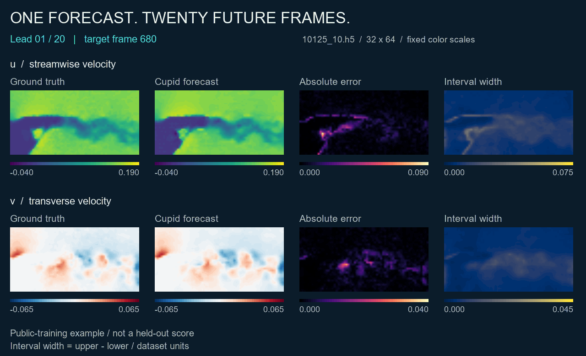
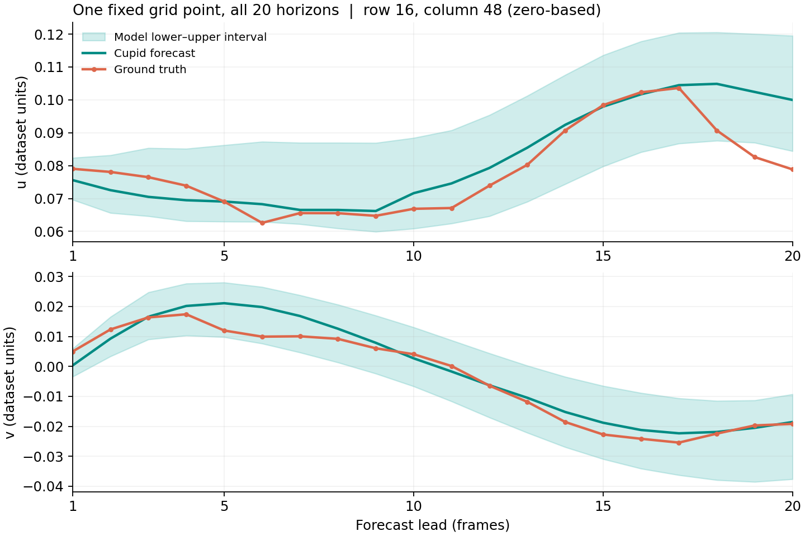

# A forecast you can inspect

[Repository home](../README.md) · [Method](method.md) · [Results](results.md) · [中文说明](#中文说明)

One forecast contains twenty future flow fields. The gallery shows **every lead
time**, together with the corresponding measurement, absolute error, and width
of the model's lower–upper interval.

<picture>
  <source media="(max-width: 600px) and (prefers-reduced-motion: reduce)" srcset="assets/forecast-comparison-mobile.png">
  <source media="(prefers-reduced-motion: reduce)" srcset="assets/forecast-comparison.png">
  <source media="(max-width: 600px)" srcset="assets/forecast-comparison-mobile.gif">
  
</picture>

[Static final horizon](assets/forecast-comparison.png) · [Full provenance](assets/forecast-provenance.json)

## Read the comparison

| Panel | What it shows |
|:--|:--|
| Ground truth | The observed future field, read **after** the forecast was issued |
| Cupid forecast | Point prediction from the frozen competition runtime |
| Absolute error | `abs(prediction − truth)` at each grid point |
| Interval width | `upper − lower`; a wider interval is not itself proof of better calibration |

Truth and prediction share the same color limits within each velocity channel.
Every color scale stays fixed across all twenty horizons. Error and width use
their own labeled scales; values are in stored dataset units. Display enlargement
is bilinear, with no field smoothing or clipping. The animation plays at an
illustrative speed, not in real time.

## Follow one grid point



This location—row 16, column 48 on the 32 × 64 evaluation grid, zero-based—was
fixed before inference. The shaded region shows the model's actual lower and
upper bounds. It is **not a guarantee of coverage** on unseen trajectories.

At this point, the streamwise forecast follows the broad trend but misses the
late drop in measured velocity; some late observations also fall outside the
bounds. Keeping these misses visible makes the relationship between prediction
error and reported uncertainty easier to inspect.

## How this example was selected

- **Trajectory:** public RealPDE `10125_10.h5`, the same file used in the original
  observation preview. It was not selected by inspecting prediction errors.
- **Window:** input frames 660–679; forecast frames 680–699, zero-based. Origin
  660 is this trajectory's first tail origin in the clean81 diagnostic split.
- **History:** reset at origin 0, then replay origins 0, 20, …, 640. Each target
  is read only after its forecast, and becomes feedback for the next step. The
  twenty displayed future frames are predicted together, without feedback from
  within that window.
- **Model:** the completed October 10 Docker-from-scratch output for submission
  948801. All 44 exported model/runtime files match the SHA256 entries in the
  [historical fresh replay](../evidence/fresh_replay.json). No model was retrained
  or modified to make these pictures.

**This is a public-training example with training overlap.** A tail window does
not make it an unseen test case, because the final model was trained on the
public data. This gallery illustrates behavior; it does not establish an
improvement, generalization result, or official score.

## Regenerate the gallery

First [train Cupid](reproduction.md) to obtain a completed Final output directory.
Raw HDF5 files and model checkpoints are not included in this repository.

Use the pinned image built by the reproduction guide. From the repository root:

```bash
TRAINED=/absolute/path/to/completed-output
TRAJECTORY=/absolute/path/to/train_real/10125_10.h5
CAPTURE=/absolute/path/to/new-empty-capture
mkdir -p "$CAPTURE"

docker run --rm --network none --gpus '"device=0"' \
  --cpus 4 --memory 12g --shm-size 1g \
  --mount type=bind,src="$(pwd)",dst=/gallery,readonly \
  --mount type=bind,src="$TRAINED",dst=/trained,readonly \
  --mount type=bind,src="$TRAJECTORY",dst=/10125_10.h5,readonly \
  --mount type=bind,src="$CAPTURE",dst=/capture \
  cupid-realpde:948801 python /gallery/scripts/capture_forecast.py \
  --trained-output /trained --trajectory /10125_10.h5 \
  --start 660 --output /capture
```

The frozen L33 runtime requires CUDA Graphs; this helper is not a CPU inference
implementation. It checks compiled execution, finite outputs, ordered bounds,
zero Real pressure, causal target access, and a repeatable trajectory reset.
The capture directory is a local rendering input, not an additional submission.

Rendering runs separately on CPU with NumPy, Matplotlib and Pillow:

```bash
python scripts/render_forecast.py \
  --capture /path/to/new-empty-capture \
  --font /path/to/Arial.ttf
```

This gallery's short inference run used Docker Engine, an H200, and the frozen
source package's pinned PyTorch 2.4.1 / CUDA 12.4 image environment. Networking was
disabled and the trained output/data were mounted read-only. It loads existing
weights; it is not another training run. The GPU differs from the **October 10
Docker/A800 reproduction**, and this visualization run is not a replacement for
that validation or a timing benchmark. Exact software versions, graph checks, hashes, and descriptive
single-window metrics are recorded in the [provenance JSON](assets/forecast-provenance.json).

## 中文说明

这组图把同一个预测窗口的 **真值、Cupid 预测、绝对误差和预测区间宽度**放在一起，
完整展示未来 20 帧。样例与时间窗在推理前固定，并非按误差挑选；空间点曲线也使用
事先指定的位置。色标固定、真值与预测共用色标。

模型使用 10 月 10 日完成 Docker 从头复训的权重，44 项导出文件哈希与历史记录一致。
先从轨迹开头顺序回放，预测结束后才读取当前真值；这 20 帧内部没有偷看未来再更新。
当前展示推理使用 H200，**不替代原有 A800/Docker 验收，也不是新增测速结果**。

这是公开训练数据上的说明性样例，不能当成未见数据泛化证据。区间宽不代表校准一定好，
更不能据此推断官方成绩。

## Attribution

Data: [AI4Science-WestlakeU / RealPDE-Competition-Data](https://huggingface.co/datasets/AI4Science-WestlakeU/RealPDE-Competition-Data).
These data-derived visualizations retain **CC BY-NC 4.0** terms. Model and
rendering: Team Cupid. See [asset attribution](assets/README.md).
